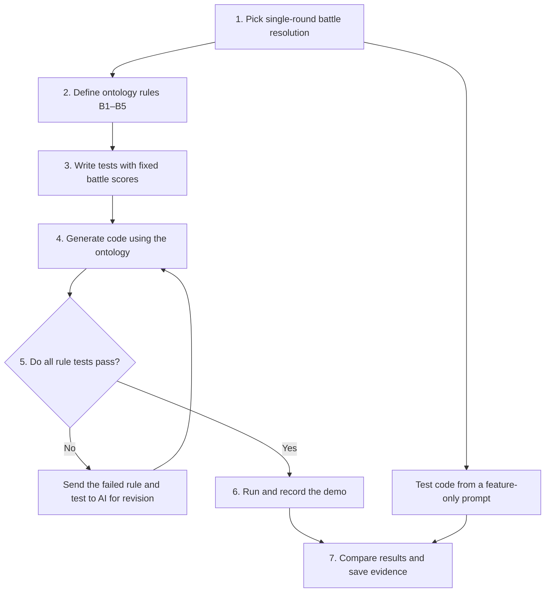

# Zombie game development pipeline

The diagram shows how the single-round battle feature moves from selection to implementation, testing, and comparison. Steps 1 and 2 define the feature and its [battle ontology](battle_ontology.md).

For example, rule B3 requires the losing side to lose at least one unit. A test can start with one human and one zombie and fix the score above zero. If the AI-generated code reports zero zombie casualties, the failed test identifies B3 and sends the code back for revision.

Use the same model and test cases for the baseline and the ontology-guided version. Record which rules each first attempt passes and how many revisions the guided version takes. This shows the effect of the initial prompt and the additional effect of testing and revision.
